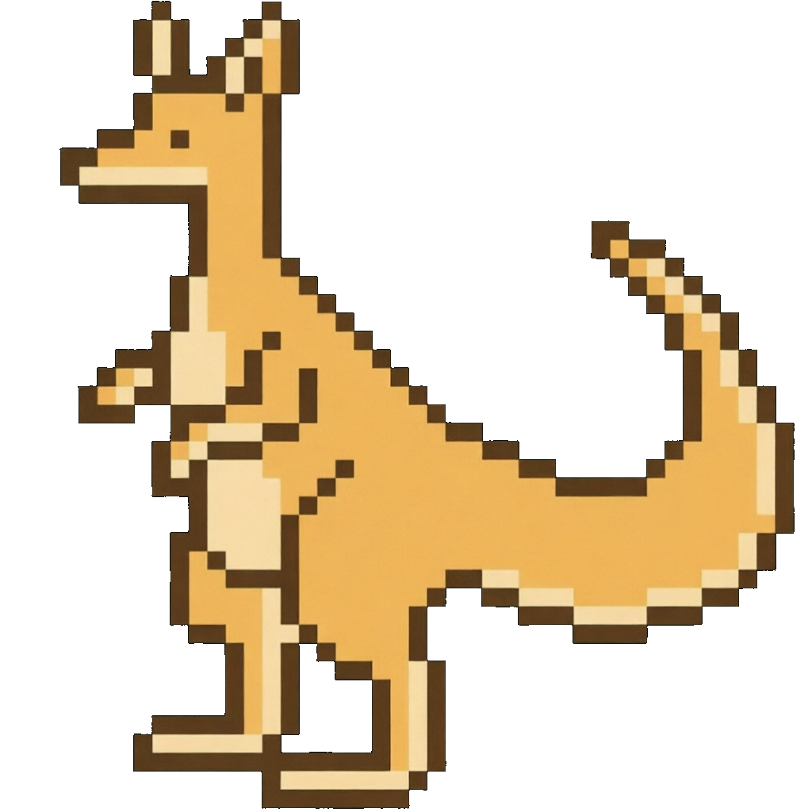

<div align="center">

# MUERZHI Universal AI Floating Ball
### MUERZHI Multi-functional AI Floating Ball

**A geek-grade Windows desktop productivity hub centered around an intuitive floating ball**  
**Screen Recording · AI Assistant Floating Island · Todo Notes · One-Click Rapid Cooling**

[简体中文](README.md) · [English](README.en.md)

<br/>



<br/>

[-0078D6?style=flat&logo=windows&logoColor=white)](https://github.com/CKKLIN/MUERZHI-Multi-functional-AI-Floating-Ball)
[-24C8DB?style=flat&logo=tauri&logoColor=white)](https://tauri.app/)
[](https://vuejs.org/)
[](https://www.typescriptlang.org/)
[](https://vitejs.dev/)
[](LICENSE)

</div>

---

## 📖 Introduction

**MUERZHI Universal AI Floating Ball** is a lightweight, ultra-responsive Windows desktop utility designed for developers and power users.

Breaking away from bulky, memory-intensive desktop widgets, MUERZHI is powered by **Tauri 2 (Rust native core) + Vue 3**, maintaining a remarkably slim memory footprint (~40 MB idle) and millisecond-level cold starts. With a physics-inspired, edge-snapping **desktop floating ball** as its unified command hub, it integrates four core superpowers:

- 🎥 **Pro Screen Recording**: Windows Graphics Capture frame pump + MediaFoundation hardware-accelerated H.264 direct-to-MP4 pipeline, bundled trimmed FFmpeg, camera PiP, and drift-free audio-video sync.
- 🤖 **AI Assistant Floating Island**: Deep integration with **Claude Code**, **Google Antigravity**, and **ZCode (Zhipu AI)** CLI agents, delivering live status visualization, in-place permission approvals, question answering, and selective auto-allow rules.
- 📝 **Todo Notes & Sticky Notes**: Apple-inspired minimalist design, Quill rich-text formatting, due reminders, and edge-pinned sticky memos with ball badge synchronization.
- 🌬️ **One-Click Rapid Cooling**: Right-click the floating ball to launch a 20-second cooling burst, leveraging ECRAM / WMI direct fan control and powercfg power-capping fallback with real-time hardware telemetry and crash self-healing.

---

## ✨ Features at a Glance

| Module | Core Capabilities | Highlights |
|---|---|---|
| **🎥 Pro Screen Recording** | Fullscreen / cross-screen region / multi-monitor capture, camera PiP, dual-stream audio mix | WGC frame pump + MF hardware-encoded MP4; pacing thread compensation; dynamic mic hot-plugging |
| **🤖 AI Assistant Island** | Live sync with Claude Code / Antigravity / ZCode; in-place tool approvals & Q&A | Automatic lifecycle hooks; capsule vs. flat strip mode; fixed transparent click-through canvas |
| **📝 Todo & Sticky Notes** | Todos / memos / due alerts / edge-docked sticky notes, floating ball badge sync | Apple-inspired UI; Quill rich-text formatting; LRU plaintext caching; multi-level priorities |
| **🌬️ One-Click Cooling** | Right-click the ball for a 20s cooling session; turbine animation; live hardware panel | Uniwill ECRAM direct write / Legion WMI control / powercfg capping; crash-safe recovery |
| **⚙️ The Floating Ball** | Edge water-drop snapping, Morandi radial petal menu, customizable items, hot bilingual switch | Native transparent top-level windows; auto-collapse on blur; global hotkeys & launch at startup |

---

## 🔍 Detailed Capabilities

### 🎥 Pro Screen Recording

Engineered natively in Rust with direct Windows graphics APIs, bundling an in-house trimmed `ffmpeg.exe` build (~8 MB) so users never need to install external video dependencies.

- **Three Capture Modes**:
  - **Full-Screen**: Quick switching across multiple monitors with full frame rate capture on high-refresh displays.
  - **Cross-Screen Region**: Drag-and-select any area with automated physical-to-logical pixel translation across mixed-DPI screens and wake-up black frame detection.
  - **Multi-Monitor Recording**: Capture multiple screens simultaneously and merge them into a single panoramic video with a single click.
- **Hardware-Accelerated Ingestion & Pacing**:
  - Windows Graphics Capture (WGC) dirty-rect frame pump driving MediaFoundation hardware encoders directly to H.264 MP4.
  - **Pacing Compensation Thread**: Overcomes WGC's idle pause on static screens by continuously pumping the latest frame with accurate wall-clock timestamps, eliminating dropped frames and audio-video drift.
  - **16 MB Dedicated Thread Stack**: Isolates complex COM/WGC/MF initializations from runtime stack overflow issues.
- **Dual-Stream Lossless WASAPI Mixing**:
  - Independent 48kHz/16-bit stereo capture for both microphone input and system audio loopback with zero CPU mixing overhead during recording; losslessly mixed via FFmpeg `amix/aresample` on stop.
  - **Dynamic In-Recording Hot-Toggling**: Turn mic or camera on/off mid-session. The timeline automatically interpolates silent waveforms during gaps to preserve exact synchronization.
- **Camera Picture-in-Picture (PiP)**:
  - Frameless floating preview window recording segmented WebM via WebView2; composited via FFmpeg overlay on stop with strict frame rate pinning.
- **Capture Protection for Utility Windows**:
  - Region borders, toolbars, and preview windows are protected via `WDA_EXCLUDEFROMCAPTURE`, remaining visible on your desktop without ever bleeding into the recorded output.
- **Post-Processing Workshop & Streaming Playback**:
  - Lossless video trimming, MP4 transcoding, high-quality GIF exporting (via bundled gif encoder), and multi-screen stitching.
  - Custom `local-video://` streaming protocol supporting HTTP Range requests for instant seeking across multi-gigabyte video files.

---

### 🤖 AI Assistant Floating Island

Brings command-line AI agents out of hidden terminal tabs directly onto your desktop workspace:

- **Full Support for Top CLI Agents**:
  - **Anthropic Claude Code** (`~/.claude`)
  - **Google Antigravity** (`~/.gemini`)
  - **Zhipu AI ZCode** (`~/.zcode`)
  - Displays authentic brand logo badges and customized theme color palettes for each agent.
- **Zero-Friction Hook Installation**:
  - Install or uninstall lifecycle hooks with one click in the settings panel. Local HTTP event dispatching over `127.0.0.1` (auto port scanning 60000–60019).
- **Live Multi-Session Perception**:
  - Breathing status animations: `Thinking`, `Working`, `Notification (Pending Approval)`, `Done`, `Error`, and `Idle`.
  - Parallel tracking of concurrent sessions with automatic extraction of session titles.
- **In-Place Permission Approval**:
  - When an AI agent requests execution of shell commands, file modifications, or tool calls, a frosted-glass card pops up on the island displaying the exact tool name and parameters.
  - Allow or deny directly on your desktop without leaving your current editor or browser.
- **Interactive Question Answering**:
  - Respond to multiple-choice and free-form prompts directly on the island and send answers straight back to the agent CLI.
- **Selective Auto-Allow & Expiry Rules**:
  - Global auto-allow switch or granular per-session auto-approval whitelist.
  - Configurable card expiration timers to prevent stale requests from lingering on your screen.
- **Minimalist Aesthetics & Click-Through Precision**:
  - Switch freely between **Classic Rounded Capsule** and **Ultra-Thin Flat Strip (Island Flat)**.
  - Employs a fixed-dimension transparent canvas coupled with physical visible-region click-through logic to ensure silky transitions without WebView2 resizing artifacts.

---

### 🌬️ One-Click Rapid Cooling

**Right-click the center circle of the floating ball** to trigger an instant 20-second cooling burst with an animated rotating fan graphic:

- **Dual-Layer Hardware Control**:
  - **ECRAM Direct Control**: On **Uniwill ODM** laptops (MECHREVO, TongFang, Colorful, etc.), writes directly to EC registers via the factory driver to force fans to 100% full speed.
  - **Lenovo Legion WMI**: Toggles full-speed gaming fan mode via direct WMI calls.
- **Smart Power-Capping Fallback**:
  - On devices without direct fan hooks, automatically invokes Windows `powercfg` to cap maximum CPU frequency, curtailing thermal spikes before safely restoring your default power scheme.
- **Real-Time Telemetry Dashboard**:
  - Displays a 20s countdown, CPU temperature, and live CPU / GPU / Disk / Memory usage graphs.
  - **Honest Telemetry**: Clearly indicates which cooling tier is active (*Fan at Full Speed*, *Power-Capped Cooling*, or *Temperature Monitoring Only*).
- **Crash-Safe Self-Healing**:
  - Includes a watchdog mechanism that automatically cleans up residual state and restores original system power settings upon application relaunch if interrupted unexpectedly.

---

### 📝 Todo & Sticky Notes

A sleek desktop companion for capturing fleeting thoughts and managing high-priority tasks:

- **Apple-Inspired Segmented Navigation**: Smoothly glide between *All*, *Todos*, and *Memos*.
- **Fine-Tuned Quill Rich-Text Editing**:
  - Rich typography with bold, highlights, ordered/unordered lists, and inline images.
  - LRU plaintext caching ensures lightning-fast scrolling and searching even with extensive graphical notes.
- **Four-Tier Priority Matrix**:
  - Urgent, High, Medium, and Low tiers distinguished by soft, low-saturation hues.
- **Interactive Reminders & Ball Sync**:
  - Red counter badge on the floating ball tracking pending items.
  - Pulsing red glow on the ball and dedicated desktop reminder popups when tasks reach their due time.
- **Edge Sticky Notes**:
  - Pin essential notes to screen borders as semi-transparent floating widgets.

---

### ⚙️ The Floating Ball & User Experience

The central axis of your desktop interactions:

- **Physics-Inspired Water-Drop Snapping**: Drag freely anywhere. When released near the display edges, it smoothly morphs into an unobtrusive water droplet docked against the border.
- **Morandi Petal Menu**: Click the ball to bloom a radial menu giving one-click access to Recorder, AI Island, Todos, and Settings; auto-collapses on blur.
- **Modular Customization**: Toggle individual menu buttons on or off in the settings to curate your ideal desktop companion.
- **Instant Bilingual Switching**: Seamless, on-the-fly toggling between Simplified Chinese and English across all native windows without requiring a restart.
- **System Integration**: Configurable autostart at login, always-on-top toggle, position persistence, and one-click screen-center reset.

---

## 🧱 Architecture & Tech Stack

```
┌─────────────────────────────────────────────────────────────┐
│                    MUERZHI Floating Ball                    │
│    (Vue 3.5 + Pinia + TypeScript 6.0 + Vite 8.0 + Hash Router)│
└──────────────┬───────────────────────────────┬──────────────┘
               │                               │
       IPC (tauri::invoke)             IPC (tauri::emit/listen)
               │                               │
┌──────────────▼───────────────────────────────▼──────────────┐
│                    Tauri 2 (Rust Backend)                   │
├─────────────────┬───────────────────────────┬───────────────┤
│  🎥 Recording   │  🤖 Agent Hub             │  🌬️ Cooling   │
│  - WGC FramePump│  - Axum HTTP Server(60000)│  - ECRAM Write│
│  - MF H.264 MP4 │  - Multi-session SM       │  - Legion WMI │
│  - WASAPI Audio │  - Claude / Antigravity / │  - powercfg   │
│  - Trimmed FFmpeg  ZCode Lifecycle Hooks    │    Fallback   │
├─────────────────┴───────────────────────────┴───────────────┤
│  🪟 Native HTML Windows (public/windows/*.html)             │
│  - Ball · AI Island · Recording Toolbar · Camera PiP · Todo │
└─────────────────────────────────────────────────────────────┘
```

| Layer | Technology | Role |
|---|---|---|
| **Desktop Framework** | **Tauri 2 (Rust)** | High-performance OS bindings, multi-window orchestration, ultra-low resource usage |
| **Main UI Frontend** | **Vue 3.5 + Pinia + TypeScript** | Modular control center (recording panel, AI settings, todo board, general preferences) |
| **Native Windows** | **HTML5 + CSS3 + Pure JS** | Zero-bundler static pages communicating directly with Rust via `window.__TAURI__` |
| **Screen Ingestion** | **Windows Graphics Capture (WGC)** | Direct3D surface hardware capture coupled with a dedicated pacing thread |
| **Video Encoding** | **MediaFoundation** | Direct-to-disk hardware-accelerated MP4 encoding (NVENC / Intel QSV / AMD AMF) |
| **Audio Capture** | **WASAPI (Audio Client)** | Dual-stream lossless capture for microphone and loopback audio |
| **Media Toolkit** | **Trimmed FFmpeg (~8 MB)** | Bundled in-house binary for lossless concatenation, audio mixing, PiP overlay, and GIF generation |
| **Agent Server** | **Axum Web Framework** | Local `127.0.0.1` HTTP service driving multi-session state machines and in-place approvals |
| **Build & Packaging** | **Vite 8 + Tauri Bundler** | Rapid builds producing standard Windows NSIS x64 setup executables |

---

## 🚀 Installation & Usage

### End Users

1. Head over to the [Releases](../../releases) section of this repository.
2. Download the latest `MUERZHI-x.x.x-setup.exe`.
3. Run the installer (customize install path; desktop and start menu shortcuts are generated automatically).
4. Launch the app to see the floating ball appear in the center of your screen:
   - **Left-click**: Expand the radial petal menu.
   - **Right-click center**: Trigger instant one-click cooling 🌬️.

---

## 💻 Developer Guide

### Prerequisites

- **OS**: Windows 10 / 11 (x64)
- **Node.js**: ≥ 20.x (LTS recommended)
- **Package Manager**: npm
- **Rust Toolchain**: Rust ≥ 1.77 (MSVC toolchain), Visual Studio C++ Build Tools, and the Windows 10/11 SDK

### Getting Started

```bash
# 1. Clone the repository
git clone https://github.com/CKKLIN/MUERZHI-Multi-functional-AI-Floating-Ball.git
cd MUERZHI-Multi-functional-AI-Floating-Ball

# 2. Install dependencies (npmmirror registry configured in .npmrc)
npm install

# 3. Start development mode (Vite frontend dev server + Rust cargo run with dual hot-reload)
npm run dev
```

> **Tips**:  
> - `npm run dev:web`: Starts only the Vite frontend dev server (useful for standalone UI tuning).  
> - `npm run dev:fast`: Quick development mode bypassing extended checks.

### Building NSIS Installer

```bash
# Compile frontend and generate NSIS x64 installer
npm run build
```

Upon completion, the installer will be located at:  
`src-tauri/target/release/bundle/nsis/MUERZHI_x.x.x_x64-setup.exe`

> The build pipeline automatically bundles the trimmed `ffmpeg.exe`, application icons, and the three agent hook scripts (`clawd-hook.js`, `antigravity-hook.js`, and `zcode-hook.js`) into the application distribution.

### Testing & Verification

```bash
# Vue & TypeScript type checking
npx vue-tsc

# Rust unit tests (61 tests covering i18n, settings, todos, agent state machine, cooling policies, WAV verification, etc.)
cd src-tauri && cargo test --test unit
```

> **Note**: On Windows, unit tests must specify the explicit test target `--test unit`. Running `cargo test --lib` directly will fail with `STATUS_ENTRYPOINT_NOT_FOUND` due to missing comctl32 v6 manifests.

Hardware smoke testing (requires an active Windows desktop session):

```bash
cd src-tauri && cargo test --test unit -- --ignored --nocapture
```

---

## ❓ Frequently Asked Questions (FAQ)

<details>
<summary><b>Q: Why is the camera preview window black during screen recording?</b></summary>
A: The camera preview operates inside a WebView2 container. Accessing camera hardware requires system media permissions. MUERZHI automatically grants camera and microphone requests internally via <code>PermissionRequested</code>. If the screen remains black, ensure that desktop applications have permission to access your camera under Windows "Settings → Privacy & Security → Camera".
</details>

<details>
<summary><b>Q: Why does region recording on a secondary display offset coordinates or capture black frames?</b></summary>
A: Most multi-monitor capture utilities experience coordinate displacement when converting between physical and logical pixels under mixed DPI scaling. MUERZHI computes exact monitor bounds. Additionally, if a secondary display was just awakened from sleep, Windows GDI might yield momentary black frames; our built-in probe automatically retries wake-up captures.
</details>

<details>
<summary><b>Q: Why does cooling mode display "Power-Capped Cooling" on my device?</b></summary>
A: MECHREVO, TongFang, and Colorful laptops built on Uniwill ODM architectures support direct ECRAM fan control, and selected Lenovo Legion laptops support direct WMI switching. Other laptop manufacturers (such as Dell, Huawei, ThinkPad standard lines) lock fan control within closed BIOS firmware. For these models, MUERZHI automatically activates its secondary defense: curtailing thermal spikes via Windows <code>powercfg</code> CPU frequency regulation and safely restoring your default power scheme after 20 seconds.
</details>

<details>
<summary><b>Q: Why isn't the AI Island displaying my active Claude / Antigravity / ZCode session?</b></summary>
A: Open "Settings → AI Settings" from the floating ball menu and verify that the integration toggle for your target agent CLI is enabled (installing its hook). When you launch your agent in a terminal, the hook script connects to the local service on port 60000. If you just initiated a session, trigger a prompt or wait 2–3 seconds for the state to sync to the desktop island.
</details>

---

## 📄 License & Acknowledgments

- This project is licensed under the [Apache License 2.0](LICENSE).
- Special thanks to the [Tauri](https://tauri.app/) team for the exceptional Rust desktop application framework.
- Gratitude to the [FFmpeg](https://ffmpeg.org/) project for foundational multimedia libraries.
- Thank you to all open-source contributors and community developers who provide ideas, testing, and feedback!

<div align="center">

**MUERZHI Universal AI Floating Ball** — Bringing lightness and power back to your desktop.  
Feel free to open an [Issue](../../issues) to share ideas or contribute!

[Back to top ↑](#muerzhi-universal-ai-floating-ball)

</div>
