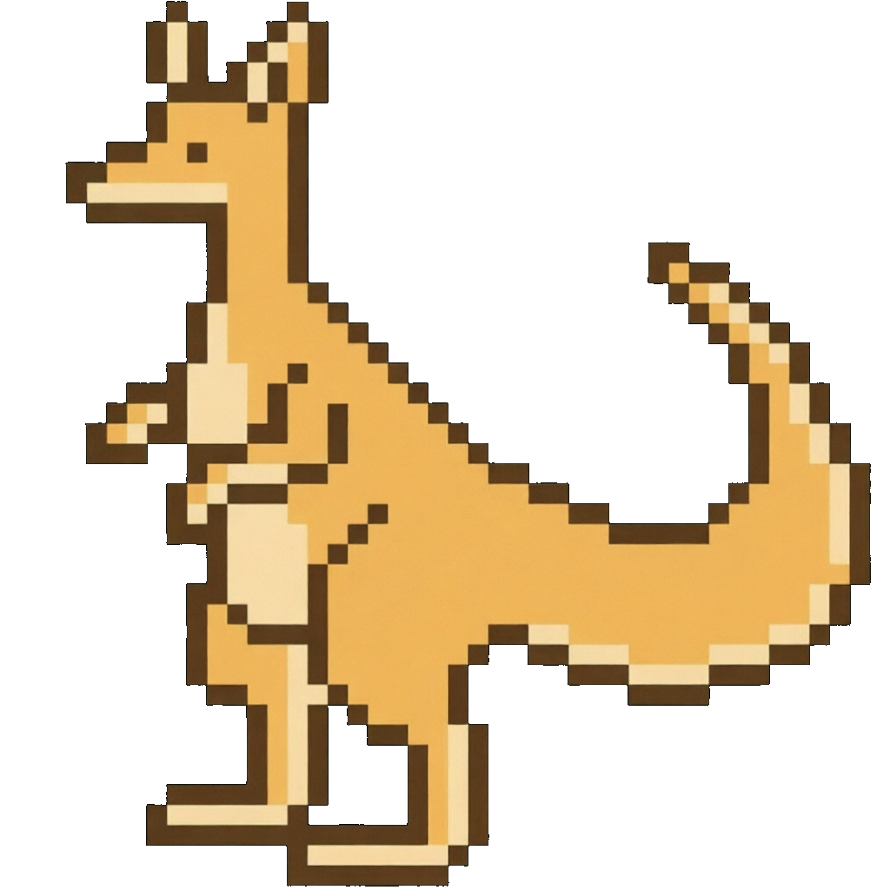

<div align="center">

# MUERZHI 万能 AI 悬浮球
### MUERZHI Multi-functional AI Floating Ball

**以悬浮球为统一入口的 Windows 桌面极客级生产力工具**  
**屏幕录制 · AI 助手悬浮岛 · 待办便签 · 一键极速散热**

[简体中文](README.md) · [English](README.en.md)

<br/>



<br/>

[-0078D6?style=flat&logo=windows&logoColor=white)](https://github.com/CKKLIN/MUERZHI-Multi-functional-AI-Floating-Ball)
[-24C8DB?style=flat&logo=tauri&logoColor=white)](https://tauri.app/)
[](https://vuejs.org/)
[](https://www.typescriptlang.org/)
[](https://vitejs.dev/)
[](LICENSE)

</div>

---

## 📖 项目简介

**MUERZHI 万能 AI 悬浮球** 是一款专为 Windows 打造的轻量高效常驻桌面工具。

它打破传统桌面小工具分散、笨重、高内存占用的弊端，采用 **Tauri 2 (Rust 原生内核) + Vue 3** 架构，内存占用轻量（日常静默仅约 40MB），毫秒级极速冷启。通过一个具有物理惯性吸附的**桌面悬浮球**，作为四大核心生产力模块的统一中枢：

- 🎥 **高清屏幕录制**：底层 Windows Graphics Capture 帧泵 + MediaFoundation 硬件编码直出 MP4，内置剪裁版 FFmpeg，支持摄像头画中画与音画无损对齐。
- 🤖 **AI 助手悬浮岛**：深度打通 **Claude Code**、**Google Antigravity** 与 **ZCode (智谱 AI)** 三大 CLI 智能体，状态感知、就地权限审批、问题答复与选择性自动放行。
- 📝 **待办便签与贴屏备忘**：Apple 极简质感设计，Quill 富文本混排，到期强提醒与屏幕边缘吸附贴屏便签。
- 🌬️ **一键极速散热**：右键悬浮球触发 20 秒强冷，ECRAM / WMI 风扇直控 + powercfg 功耗限制保底降温，实时硬件监控与崩溃自愈。

---

## ✨ 核心功能总览

| 模块 | 核心能力 | 技术亮点 |
|---|---|---|
| **🎥 专业屏幕录制** | 全屏 / 跨屏选区 / 多屏独立录制，摄像头画中画，麦克风/系统声混录 | WGC 底层采集 + MF 硬件直编 MP4；定速补帧机制；录制中麦克风热插拔 |
| **🤖 AI 助手悬浮岛** | 实时感知 Claude Code / Antigravity / ZCode；权限就地审批与问题答复 | 原生 Lifecycle Hooks 自动接线；胶囊态/横条态切换；固定透明穿透画布 |
| **📝 待办与贴屏便签** | 待办 / 自由备忘 / 到期提醒 / 钉在边缘贴屏常驻，悬浮球角标感知 | Apple 极简风格；Quill 图文富文本；LRU 纯文本缓存防卡顿；多级优先级 |
| **🌬️ 一键散热模式** | 右键悬浮球 20 秒极速强冷；风扇转动动效；实时硬件监控面板 | Uniwill ECRAM 直写 / Legion WMI 调控 / powercfg 智能功耗控温；崩溃自愈防护 |
| **⚙️ 悬浮球本体** | 边缘水滴智能吸附、莫兰迪花瓣菜单、菜单项模块自定义、中英双语热切换 | 原生异形透明置顶窗；失焦自动收起；Windows 全局快捷键与开机自启 |

---

## 🔍 深度功能特性

### 🎥 专业屏幕录制 (Screen Recording)

采用 Rust 原生实现的高性能视频捕获管线，安装包内置精简至约 8MB 的专用剪裁版 `ffmpeg.exe`，无需用户安装配置任何额外运行环境。

- **三种捕获场景**：
  - **全屏录制**：支持多显示器快速切换，高分辨率高刷屏满帧捕捉。
  - **跨屏自由选区**：拖拽任意矩形框选，自动进行物理像素与逻辑像素高 DPI 精准换算，支持副屏唤醒抗黑帧探测。
  - **多屏独立录制**：多个显示器并发捕捉，录制完成一键合成全景视频。
- **硬核底层采集与补帧**：
  - 基于 Windows Graphics Capture (WGC) 脏区捕获，直接送入 MediaFoundation 硬件编码器直出 H.264 MP4。
  - **独创定速补帧（Pacing）机制**：针对静止桌面 WGC 停止投帧的特性，独立 Pacing 线程以恒定时间戳推帧，彻底解决静止画面丢帧及音画时间轴漂移。
  - **16MB 独立大栈线程隔离**：规避 Windows 复杂 COM/WGC/MF 初始化导致的栈溢出崩溃问题。
- **WASAPI 双路无损混音**：
  - 麦克风输入与系统环回声（Loopback）独立采集成 48kHz/16bit 立体声，录制期零混音 CPU 消耗，停止后由 FFmpeg `amix/aresample` 无损混流。
  - **录制中动态开关/热插拔**：录制中随时开关麦克风，底层精准记录时间轴并在静音段自动填充零分贝静音波形，成品严格音画对齐。
- **摄像头画中画 (PiP)**：
  - 独立透明悬浮窗实时预览，WebView2 底层分块自录 WebM，停止后由 FFmpeg 精准重编码 overlay 压入主画面，帧率严格钉死输出。
- **原生辅助窗防摄录**：
  - 选区边框、操作工具栏、摄像头预览窗均配置 `WDA_EXCLUDEFROMCAPTURE` 保护，用户桌面可见但绝不会被录进成片。
- **后期工坊与流式回放**：
  - 支持 MP4 转码、精准视频裁剪、高质量 GIF 导出（内置专属 gif 编码器）、多屏画面拼接。
  - 自定义 `local-video://` 原生流式协议，支持 HTTP Range 范围请求，GB 级大文件秒开播放、任意拖拽无卡顿。

---

### 🤖 AI 助手悬浮岛 (Agent Floating Island)

深度接入终端智能体生命周期，把原本藏在终端深处的 AI 工作状态直观呈现在桌面上：

- **深度支持三大主流 CLI 智能体**：
  - **Anthropic Claude Code** (`~/.claude`)
  - **Google Antigravity** (`~/.gemini`)
  - **智谱 AI ZCode** (`~/.zcode`)
  - 识别并展示各智能体专属 **品牌 Logo Badge** 与主题标识。
- **无感自动接线 (Lifecycle Hooks)**：
  - 设置界面一键为对应 CLI 安装/卸载专用 Hook 脚本，本地轻量 HTTP 通信（127.0.0.1 智能端口探测），零侵入、零多余配置。
- **多会话状态实时感知**：
  - 悬浮岛动态光环呼吸反馈：`思考中 (Thinking)`、`工作中 (Working)`、`等待审批 (Notification)`、`任务完成 (Done)`、`报错 (Error)`、`空闲 (Idle)`。
  - 多会话并行跟踪，自动读取终端会话真实标题，多任务游刃有余。
- **权限就地审批 (In-place Permission Approval)**：
  - 当智能体请求执行敏感 Bash 命令、读写文件或调用系统工具时，悬浮岛弹出半透明毛玻璃审批卡片，直接展示工具名与参数细节。
  - 屏幕上直接点击 **允许 / 拒绝**，无需来回切换命令行窗口。
- **问题就地答复 (Interactive Question Answering)**：
  - 支持智能体多选/单选/自由输入交互提问，就地完成回答并直接反哺 CLI。
- **选择性自动放行与超时管理**：
  - 支持一键开启全局自动放行。
  - 支持针对特定活跃会话开启选择性自动审批（Auto-allow Session），兼顾极客效率与系统安全。
  - 审批卡片支持超时自动失效（防止遗留卡片长期堆积在桌面）。
- **极简外观与穿透技术**：
  - 支持**经典圆角胶囊**与**极简扁平横条（Island Flat）**双外观形态自由切换。
  - 采用固定尺寸透明画布 + 物理可见区域精确穿透算法，展开与收起纯 CSS 优雅形变，彻底消除 WebView2 窗口位移残影与点击误阻挡。

---

### 🌬️ 一键极速散热 (One-Click Cooling)

只需**右键点击悬浮球中央圆圈**，瞬间开启 20 秒极速物理降温，环形菜单如涡轮风扇般高速旋转：

- **真实双层硬件控制**：
  - **ECRAM 风扇直控**：针对机械革命（MECHREVO）、同方（TongFang）、七彩虹（Colorful）等 **Uniwill ODM** 机型，通过驱动直写 EC 寄存器拉满风扇全速强冷（效果等同官方电竞控制台强冷）。
  - **联想 Legion WMI 直控**：调用 WMI 底层接口直接切换拯救者全速风扇模式。
- **智能安全降级保底**：
  - 对不支持风扇直接调控的机型，自动降级为调用 `powercfg` 限制 CPU 峰值最大运行频率辅助控温，降温结束后毫秒级自动精准恢复默认电源计划。
- **实时监控面板**：
  - 悬浮展开半透明状态看板，实时监测 20 秒倒计时、CPU 核心温度、CPU / GPU / 磁盘 / 内存实时占用率。
  - **诚实状态反馈**：明确标注当前生效的实际散热杠杆（风扇已全速 / 功耗散热中 / 温度监测中），绝不虚假宣传。
- **崩溃自愈与安全性**：
  - 配备看门狗安全保障机制，即便应用遭遇异常断电或强行终止，下次启动时会自动扫描残留标记并安全恢复所有被修改的电源设置。

---

### 📝 待办便签与贴屏备忘 (Todo & Sticky Notes)

专为日常碎片化灵感记录与任务追踪设计的桌面随手记：

- **Apple 风格极简分段控件**：一键平滑切换「全部」、「待办 (Todo)」、「备忘 (Memo)」。
- **Quill 深度调优富文本编辑**：
  - 支持粗体、高亮、有序/无序列表、图文混排。
  - 列表级 LRU 纯文本缓存优化，万字图文便签列表滑动与检索依旧丝滑不卡顿。
- **多维度优先级体系**：
  - 紧急 (Urgent)、高 (High)、中 (Medium)、低 (Low) 四阶色彩卡片，一眼厘清轻重缓急。
- **强提醒与悬浮球联动**：
  - 悬浮球右上角动态提示未完成事项数量红色气泡角标。
  - 任务到期时悬浮球呈现呼吸红光闪烁，并触发桌面独立提醒弹窗。
- **贴屏便签 (Sticky Notes)**：
  - 核心待办一键“钉”在屏幕四周边缘，半透明常驻置顶，工作进度时刻在眼前。

---

### ⚙️ 悬浮球本体与交互 (The Floating Ball)

桌面交互体验的灵魂中枢：

- **物理水滴边缘吸附**：任意拖拽移动，松手靠近屏幕左右边缘时，自动平滑化作“半月水滴”吸附贴边，绝不遮挡日常视线；悬停即可唤醒。
- **莫兰迪配色花瓣菜单**：点击展开优雅环形花瓣菜单，录屏、AI、待办、设置一触即达；点击空白处或失焦自适应轻柔收拢。
- **模块化按需定制**：在设置中可自由勾选开启或隐藏各个功能菜单项，随心定制专属轻盈形态。
- **全局双语即时热切换**：全栈原生窗口与 Vue 界面支持简体中文 / 英文毫秒级同步切换，无需重启应用。
- **个性化设置**：支持开机自启、窗口始终置顶、屏幕初始位置记忆与一键重置居中。

---

## 🧱 架构与技术栈

```
┌─────────────────────────────────────────────────────────────┐
│                    MUERZHI Floating Ball                    │
│    (Vue 3.5 + Pinia + TypeScript 6.0 + Vite 8.0 + Hash Router)│
└──────────────┬───────────────────────────────┬──────────────┘
               │                               │
       IPC (tauri::invoke)             IPC (tauri::emit/listen)
               │                               │
┌──────────────▼───────────────────────────────▼──────────────┐
│                    Tauri 2 (Rust 后端)                       │
├─────────────────┬───────────────────────────┬───────────────┤
│  🎥 录制管线     │  🤖 Agent 集成             │  🌬️ 散热引擎  │
│  - WGC FramePump│  - Axum HTTP Server (60000)│  - ECRAM 直写 │
│  - MF H.264 MP4 │  - Multi-session SM       │  - Legion WMI │
│  - WASAPI Audio │  - Claude/Antigravity/    │  - powercfg   │
│  - 内置 FFmpeg  │    ZCode Lifecycle Hooks  │    降级保底   │
├─────────────────┴───────────────────────────┴───────────────┤
│  🪟 原生手写 HTML 窗口体系 (public/windows/*.html)          │
│  - 悬浮球 · AI 岛 · 录制工具栏 · 摄像头预览 · 待办提醒/贴屏便签│
└─────────────────────────────────────────────────────────────┘
```

| 层次 | 技术选型 | 职能说明 |
|---|---|---|
| **桌面框架** | **Tauri 2 (Rust)** | 高性能系统级调度、窗口体系、低资源开销、无 Electron 冗余 |
| **主界面前端** | **Vue 3.5 + Pinia + TypeScript** | 模块化交互面板（录屏控制、AI 设置、待办便签、通用设置） |
| **原生手写窗口** | **HTML5 + CSS3 + 纯 JS** | 无打包开销的轻量静态页，通过 `window.__TAURI__` 与 Rust 实时通信 |
| **屏幕录制** | **Windows Graphics Capture (WGC)** | 现代 Direct3D 表面硬件捕获，配合独立 Pacing 补帧线程 |
| **硬件编码** | **MediaFoundation** | 原生调用硬件编码器直出 MP4（支持 NVENC / Intel QSV / AMD AMF） |
| **音频捕获** | **WASAPI (Audio Client)** | 麦克风与系统扬声器环回（Loopback）独立无损双路采集 |
| **媒体处理** | **精简版 FFmpeg (~8MB)** | 仓库内置裁剪二进制：无损 Concat、Amix 混流、PiP Overlay、GIF 压制 |
| **Agent 服务** | **Axum 异步 Web 框架** | 本地 127.0.0.1 端口通信，多会话状态机驱动，挂起式权限审批 |
| **构建分发** | **Vite 8 + Tauri Bundler** | 快速构建，输出标准 Windows NSIS x64 安装包 |

---

## 🚀 下载与安装

### 普通用户

1. 前往本仓库的 [Releases](../../releases) 页面。
2. 下载最新版本的 `MUERZHI-x.x.x-setup.exe`。
3. 双击安装（支持自定义安装路径，自动创建桌面与开始菜单快捷方式）。
4. 启动后，优雅的悬浮球将呈现在屏幕中央：
   - **左键单击**：展开花瓣功能菜单。
   - **右键单击中央**：立刻体验极速一键散热 🌬️。

---

## 💻 开发者指南

### 环境要求

- **操作系统**：Windows 10 / 11 (x64)
- **Node.js**：≥ 20.x （推荐使用 LTS 版本）
- **包管理器**：npm
- **Rust 工具链**：Rust ≥ 1.77（MSVC 工具链），需安装 Visual Studio C++ 生成工具以及 Windows 10/11 SDK

### 快速开始

```bash
# 1. 克隆本仓库
git clone https://github.com/CKKLIN/MUERZHI-Multi-functional-AI-Floating-Ball.git
cd MUERZHI-Multi-functional-AI-Floating-Ball

# 2. 安装前端依赖（已在 .npmrc 中配置 npmmirror 国内镜像，安装顺畅）
npm install

# 3. 启动开发模式（双向热重载：Vite 前端 dev server + Rust 后端 cargo run）
npm run dev
```

> **提示**：  
> - `npm run dev:web`：仅启动 Vite 纯前端服务（方便独立调试页面与样式组件）。  
> - `npm run dev:fast`：跳过完整检查的快速开发模式。

### 打包构建 (NSIS 安装包)

```bash
# 编译前端并生成 NSIS x64 安装包
npm run build
```

打包成功后，安装包产物将输出在：  
`src-tauri/target/release/bundle/nsis/MUERZHI_x.x.x_x64-setup.exe`

> 打包过程会自动将裁剪版 `ffmpeg.exe`、Logo 图标以及三大智能体 Hook 脚本（`clawd-hook.js`、`antigravity-hook.js`、`zcode-hook.js`）完整封装至安装包资源中，开箱即用。

### 自动化测试与校验

```bash
# 前端类型检查
npx vue-tsc

# Rust 模块单测（61 项全量覆盖：i18n / 设置 / 待办 / Agent 状态机 / 散热策略 / 编码器探测 / 音频 WAV 校验等）
cd src-tauri && cargo test --test unit
```

> **注意**：Windows 平台的单元测试必须指定显式目标 `--test unit`。若直接运行 `cargo test --lib` 会因缺少 `comctl32 v6 manifest` 报 `STATUS_ENTRYPOINT_NOT_FOUND` 错误。

真机冒烟测试（需在真实 Windows 桌面环境下执行）：

```bash
cd src-tauri && cargo test --test unit -- --ignored --nocapture
```

---

## ❓ 常见问题排查 (FAQ)

<details>
<summary><b>Q: 屏幕录制时摄像头预览窗口一直是黑屏？</b></summary>
A: 本应用摄像头预览走 WebView2 容器，首次调用系统摄像头可能需要权限。MUERZHI 内部已通过 <code>PermissionRequested</code> 底层放行摄像头与麦克风。如果仍黑屏，请确认 Windows「系统设置 → 隐私和安全性 → 摄像头」中已允许桌面应用访问摄像头设备。
</details>

<details>
<summary><b>Q: 在副屏上进行区域录制，生成的视频为什么坐标偏移或黑屏？</b></summary>
A: 绝大多数多显示器录屏工具在混合 DPI 环境下会出现物理像素与逻辑像素换算错位。MUERZHI 已经对各显示器的 Bounds 进行精准换算。若副显示器从待机/断开状态刚被唤醒，系统 GDI 可能会有短暂黑帧，应用内置了唤醒重试探测；请确保副屏处于点亮状态即可。
</details>

<details>
<summary><b>Q: 一键散热模式在我的笔记本上显示「功耗散热中」？</b></summary>
A: 机械革命、同方、七彩虹等 Uniwill ODM 笔记本支持直接通过出厂驱动直写 ECRAM 开启风扇强冷，联想部分 Legion 机型支持 WMI 调控。其他品牌（如华为、Dell、ThinkPad 普通版）通常由 BIOS 封闭接管风扇，应用会自动降级启用第二层散热策略——通过 Windows <code>powercfg</code> 智能下调 CPU 最大频率，同样能起到显著抑制发热的效果，并在 20 秒后无感还原。
</details>

<details>
<summary><b>Q: AI 助手悬浮岛没有显示我正在运行的 Claude / Antigravity / ZCode 会话？</b></summary>
A: 请打开悬浮球的「设置 → AI助手设置」，检查对应智能体的集成开关是否已开启（安装 Hook）。启动智能体 CLI 工具时，Hook 脚本会自动与本地 60000 端口服务握手。如果终端中刚启动会话，可稍微等待 2-3 秒或触发一次对话，状态将即时同步至悬浮岛。
</details>

---

## 📄 开源许可与致谢

- 本项目基于 [Apache License 2.0](LICENSE) 协议开源。
- 感谢 [Tauri](https://tauri.app/) 团队提供优秀的跨平台 Rust 应用框架。
- 感谢 [FFmpeg](https://ffmpeg.org/) 项目对音视频处理基础库的卓越贡献。
- 感谢开源社区所有提供灵感与反馈的开发者！

<div align="center">

**MUERZHI 万能 AI 悬浮球** —— 让桌面交互重归轻盈与强大。  
欢迎提交 [Issues](../../issues) 反馈建议或发起贡献！

[回到顶部 ↑](#muerzhi-万能-ai-悬浮球)

</div>
